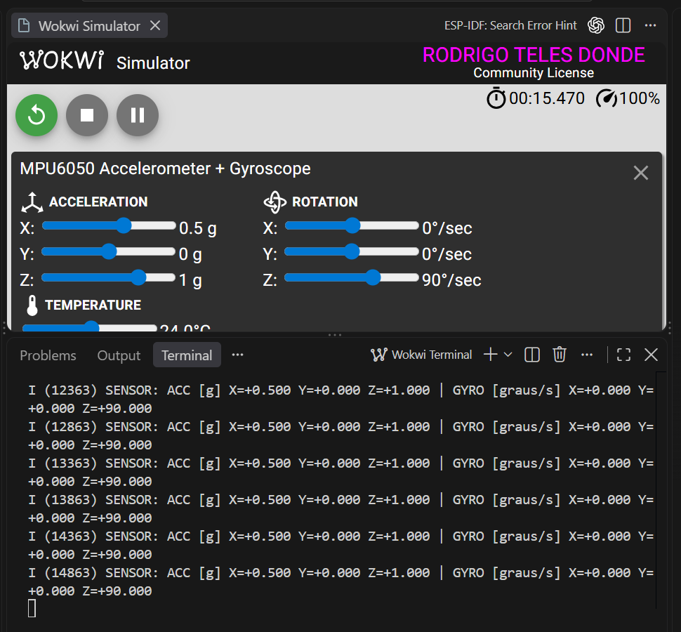

# Atividade Avaliativa Prática 2/6 — Leitura de sensor

Este projeto usa um **ESP32-S3 DevKitC-1** para ler um **MPU6050** no
simulador Wokwi. O programa foi escrito em **C**, com **ESP-IDF 5.4.2**,
e é executado pelo VS Code.

O MPU6050 mede aceleração e rotação nos eixos X, Y e Z. O programa verifica
se o sensor está respondendo, faz a configuração inicial e mostra uma nova
leitura no terminal a cada **500 ms**.

**A implementação e as evidências estão prontas para entrega.** O envio
na plataforma da disciplina ainda não foi confirmado.

## Conferência dos requisitos

Esta tabela segue os critérios informados para a atividade. Os percentuais
são os pesos da avaliação; a nota será definida pelo professor.

| Critério | Peso | O que foi conferido |
| --- | --- | --- |
| Configuração ESP-IDF e conta Wokwi | 50% | ESP-IDF instalado e usado na compilação; Wokwi com licença ativa e simulação funcionando |
| Circuito correto | 20% | ESP32-S3 e MPU6050, alimentação em 3,3 V, GND comum, SDA no GPIO 8 e SCL no GPIO 9 |
| Compilação sem erros | 20% | Programa, bootloader e tabela de partições gerados; log de compilação salvo |
| Inicialização e leituras corretas | 10% | `WHO_AM_I=0x68 OK`, sensor inicializado e leituras acompanhando as mudanças dos controles |

O código usa `app_main()`, `ESP_LOGI()` e `vTaskDelay()`, além da biblioteca
`espressif/mpu6050`. As falhas de comunicação são verificadas antes de
mostrar os valores.

## Ligações do circuito

| ESP32-S3 | MPU6050 | Para que serve |
| --- | --- | --- |
| 3V3 | VCC | Alimentar o sensor |
| GND | GND | Manter a mesma referência elétrica |
| GPIO 8 | SDA | Transmitir os dados |
| GPIO 9 | SCL | Sincronizar a comunicação |
| GND | AD0 | Selecionar o endereço 0x68 |

O circuito está em [diagram.json](diagram.json). A comunicação I2C funciona
a 100 kHz. Os pinos INT, XDA e XCL não são usados nesta atividade.

## Como executar neste computador

1. Abra a pasta do projeto no VS Code.
2. Pressione **Ctrl+Shift+B** e selecione **Atividade 02: compilar ESP-IDF**.
3. Espere **Project build complete**. Essa mensagem indica que a compilação terminou.
4. Pressione **F1** e selecione **Wokwi: Start Simulator**.
5. No terminal do Wokwi, confira **WHO_AM_I=0x68 OK** e **MPU6050 inicializado**.
6. Clique no MPU6050 e altere os controles para observar a mudança das leituras.

A licença Wokwi já foi ativada neste computador. Em uma nova instalação,
use **F1 → Wokwi: Request a New License**, entre na conta pelo navegador
e confirme a volta ao VS Code.

Também é possível compilar pelo terminal PowerShell:

```powershell
powershell -NoProfile -ExecutionPolicy Bypass -File scripts/build.ps1
```

Esse script usa a instalação local e guarda o resultado em `evidencias/build.log`.
As ferramentas de desenvolvimento não são incluídas no repositório.

Em outro computador, primeiro configure o ESP-IDF 5.4.2 e as extensões
ESP-IDF e Wokwi. No terminal do ESP-IDF, dentro da pasta do projeto, execute:

```text
idf.py set-target esp32s3
idf.py build
```

## Como entender as leituras

- **ACC [g]**: aceleração. Uma unidade g equivale a aproximadamente 9,81 m/s².
- **GYRO [graus/s]**: velocidade de rotação, em graus por segundo.
- **WHO_AM_I**: registro que identifica o sensor. O valor esperado é `0x68`.

Os seguintes resultados foram observados no Wokwi:

| Situação | Aceleração X / Y / Z (g) | Rotação X / Y / Z (graus/s) |
| --- | --- | --- |
| Controles iniciais | 0 / 0 / 1 | 0 / 0 / 0 |
| X ajustado para 0,5 g e rotação Z para 90 graus/s | 0,5 / 0 / 1 | 0 / 0 / 90 |



Se ocorrer uma falha de leitura, o programa descarta aquela amostra e tenta
novamente após 500 ms. Se o sensor não puder ser inicializado, mostra o erro
e interrompe a leitura. O teste de desconectar o sensor não foi realizado;
o tratamento de erros foi conferido no código.

## Evidências salvas

| Arquivo | O que mostra |
| --- | --- |
| [Instalação](evidencias/instalacao-eim.log) | Registro da instalação do ESP-IDF |
| [Compilação inicial](evidencias/build.log) | Compilação concluída sem erros |
| [Checagem final da compilação](evidencias/revisao-final-build.log) | Nova execução do comando de compilação, concluída sem erros |
| [Circuito e leituras iniciais](evidencias/04-circuito-leitura-inicial.png) | Montagem, licença Wokwi ativa e sensor em execução |
| [Controles iniciais](evidencias/05-controles-iniciais.png) | Valores usados no início do teste |
| [Leituras alteradas](evidencias/06-leitura-alterada.png) | Correspondência entre controles e valores lidos |
| [Screenshot final](evidencias/07-final-vscode.png) | Circuito e terminal no VS Code |
| [Inicialização](evidencias/08-inicializacao.png) | Identificação e inicialização do MPU6050 |
| [Saída serial](evidencias/serial.log) | Leituras iniciais gravadas diretamente do simulador |

O [registro de revisão](evidencias/STATUS.md) reúne as versões usadas,
os ajustes de instalação e o resultado da checagem final.

## Ajuste da biblioteca

Foi usada a biblioteca oficial **espressif/mpu6050 1.2.1**. Conforme a
página 76 da Aula 2, acrescentamos `driver` às dependências no arquivo
CMake da biblioteca para usar o ESP-IDF 5.4.2. Essa correção está salva no
projeto e acompanha qualquer cópia do repositório.

O aviso de driver I2C antigo mostrado no terminal é esperado com essa
biblioteca. As capturas confirmam que o sensor inicializa e lê corretamente.
Consulte [a origem da biblioteca](components/mpu6050/ORIGEM.md) para os detalhes.

## Entrega

Envie o [link do repositório](https://github.com/rodrigodondesenai/atividade-02-sensor)
e o [screenshot final](evidencias/07-final-vscode.png) na plataforma da disciplina.
Se houver espaço para outros anexos, inclua também a captura da inicialização.
O arquivo [ENTREGA.md](ENTREGA.md) contém um texto pronto para acompanhar o envio.

## Material de referência

- Aula 2 fornecida pelo curso: páginas 19–42 e 68–82.
- [Wokwi no VS Code](https://docs.wokwi.com/vscode/getting-started)
- [Configuração do projeto Wokwi](https://docs.wokwi.com/vscode/project-config)
- [Sensor MPU6050 no Wokwi](https://docs.wokwi.com/parts/wokwi-mpu6050)
- [Biblioteca espressif/mpu6050](https://components.espressif.com/components/espressif/mpu6050/versions/1.2.1)
